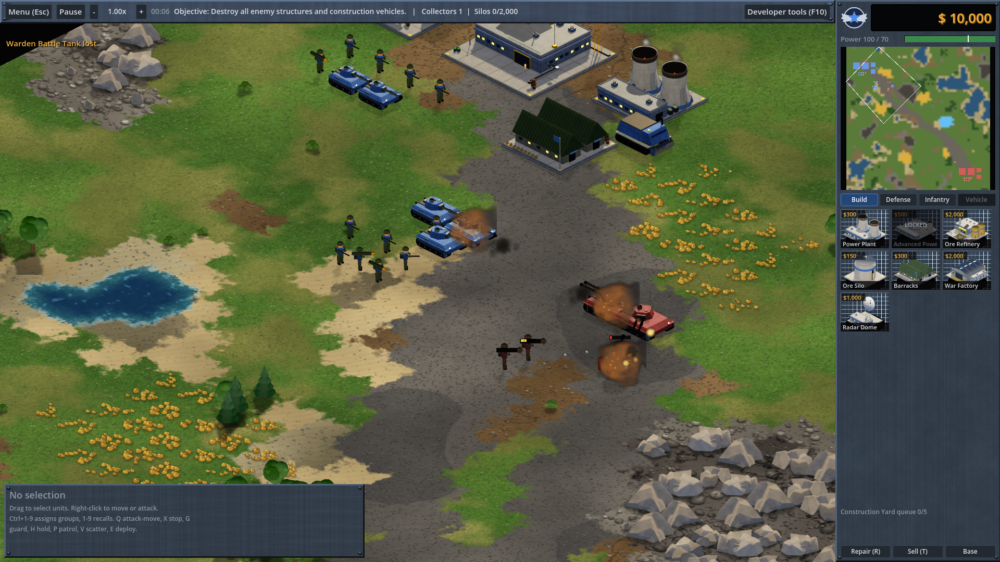

# Iron Meridian

An offline, single-player real-time strategy game in the classic 1990s base-building style,
built with **Godot 4.3** and **GDScript**. All code, artwork, sound effects and music are
original and generated by the project itself. No files from any commercial game are used.

> Development status: **phases 1-2 complete plus full 3D graphics** (playable battle, economy
> and base building, AI opponent, developer cheats, save/load, isometric 3D presentation).
> See `docs/TEST_REPORT.md` for what is tested and what is still to come.



## Graphics

The default presentation is **classic isometric**, in the style of late-90s pre-rendered RTS games:

- Units and structures are **pre-rendered sprites**: detailed 3D models (sloped armour, road wheels,
  hatches, antennas, pipes, ladders, windows, cranes, dishes) are rendered offline from the
  isometric angle into sprite sheets with baked lighting, ambient occlusion and ground shadows.
  Vehicles have 32 directions with independently rotating turrets; infantry have 8 directions with
  walk, fire and death animations; buildings have construction stages, a damaged state and animated
  parts (cranes, radar dishes, tesla-style coils). Player colours are applied through baked team masks.
- The battlefield uses 64x32-style isometric tiles (rendered at 2x for Full HD) with **hand-painted
  procedural terrain** (lush and dry grass, dirt, sand, shoreline, gravel roads, rocky ground,
  cliffs, forest floor, wooden bridges) blended with irregular transitions, animated water with shore
  foam, gold ore and blue gem clusters, and scattered trees, bushes, rocks, crates, barrels, fences,
  sandbags, lamps and wrecks.
- Sprite-sheet explosions, smoke, fire, muzzle flashes, rocket trails, tracers and electric arcs;
  craters and infantry corpses remain on the ground for a while.
- A metallic sidebar with faction insignia and illustrated build icons (cameos).

**Settings > Display > Graphics** also offers a real-time **3D** view and a light **top-down 2D**
view for low-end PCs. Command line: `-- --iso`, `-- --3d` or `-- --2d`.

All artwork is original: it is generated by the scripts in `tools/` (see the developer guide).

## Requirements

- Godot Engine **4.3** (standard build, not .NET): https://godotengine.org/download/archive/4.3-stable/
- Windows 10/11, Linux or macOS. No internet connection is needed to play.
- A graphics card with Vulkan support is recommended for the 3D view (any GPU from roughly 2014 onward).

## Run the game

1. Open Godot 4.3 and choose **Import**, then select `rts-game/project.godot`.
2. Press **F5** (Run project).

From the command line:

```
godot --path rts-game                    # main menu
godot --path rts-game -- --quickstart    # jump straight into a small skirmish with a base
godot --path rts-game -- --sandbox       # jump into sandbox mode
```

## Build a Windows executable

1. In Godot: **Editor > Manage Export Templates > Download and Install** (once).
2. **Project > Export > Add... > Windows Desktop**, then **Export Project** and pick `IronMeridian.exe`.
3. Copy the `.exe` (and `.pck` if not embedded) anywhere and run it. It works offline.

## How to play

1. Select your **Mobile Construction Vehicle** and press **E** (or the Deploy button) to build a Construction Yard.
2. In the right sidebar, click **Power Plant**. When it says **READY**, click it again and place it near your base.
3. Build an **Ore Refinery**. It comes with an **Ore Collector** that harvests automatically.
4. Build a **Barracks** and **War Factory**, train an army and destroy every enemy structure.

Watch the **power bar**: when consumption exceeds production, production slows down and
powered defenses and radar go offline.

## Controls

| Action | Input |
| --- | --- |
| Select / box-select | Left-click / left-drag |
| Add to selection | Shift + click |
| Select all of a type on screen | Double-click a unit |
| Move / attack / harvest | Right-click ground / enemy / ore |
| Set rally point | Select a production building, right-click the ground |
| Attack-move | Q, then click |
| Stop, Guard, Hold, Patrol, Scatter | X, G, H, P (then click), V |
| Deploy construction vehicle | E |
| Control groups | Ctrl+1-9 assign, 1-9 select (press twice to center) |
| Select all combat units | Z |
| Repair / Sell mode | R / T |
| Scroll camera | WASD, arrow keys, screen edges, middle-mouse drag, or the minimap |
| Zoom | Mouse wheel (zooms toward the cursor) |
| Tactical pause | F9 or Pause |
| Game speed | + / - or the top bar buttons |
| Developer tools | F10 |
| Game menu (save, load, quit) | Esc |

All keys can be rebound in **Settings**.

## Game modes

- **New Game**: quick skirmish on a medium random map against one Normal AI.
- **Skirmish**: choose map, map size, seed, factions, 0-3 AI opponents, difficulty (Easy/Normal/Hard),
  starting credits, starting forces, bonus power, resource abundance, game speed, fog of war,
  power constraints, victory condition and whether cheats are allowed.
- **Sandbox**: everything unlocked, developer tools always on, no victory condition.
- **Missions** and **Map Editor** arrive in phase 4.

## Developer tools (cheats)

Press **F10** (cheats must be allowed in skirmish setup; they are always on in Sandbox).
The panel has a text console and graphical tabs (Economy, Production, Spawn, Selected,
Battlefield). Every button runs the same command as the console, so both change the real game
state. Examples:

```
money set 1000000          money add 500000          money subtract 10000
resources set ore 999999   resources add gems 50000  resources set all 999999
power set 999999           storage unlimited on
build instant on           units instant on          build free on        units free on
queue unlimited on         prereq off                research instant     deploy instant on
repair instant on          buildanywhere on
spawn mtank 10             spawn htank 5 enemy at 40 30                   spawn harvester
health set 50              health full               invulnerable on      teleport 20 20
destroy selected confirm   remove enemies confirm    remove friendly confirm
reveal on                  fog off                   enemies reveal on    freeze on
ai off                     victory                   defeat confirm       speed 4      speed reset
powerreq off               depletion off             autorepair units on  autorepair buildings on
persist match|session|saved                          reset                help
```

Destructive commands need `confirm` at the end (or a second click in the panel). Credits are
capped at 999,999,999,999 so very large values never overflow.

## Saves and settings

Saves are JSON files in Godot's user folder (`%APPDATA%\Godot\app_userdata\Iron Meridian\saves`
on Windows). An autosave is written every 5 minutes by default (configurable).
Settings are stored in `settings.cfg` in the same folder.

## Run the automated tests

```
godot --headless --path rts-game res://tests/test_runner.tscn
```

Exit code 0 means every check passed. See `docs/TEST_REPORT.md`.

## Documentation

- `docs/DEVELOPER_GUIDE.md`: architecture, data files, adding units/buildings/factions/maps.
- `docs/TEST_REPORT.md`: tests run, results and known limitations.
